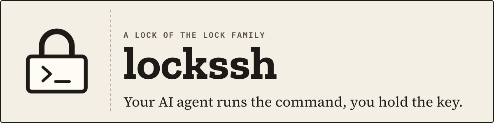
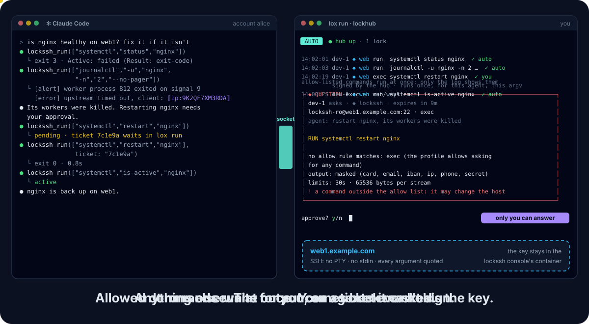

<p align="center">
  <picture>
    <source media="(prefers-color-scheme: dark)" srcset="docs/assets/banner-dark.svg">
    
  </picture>
</p>

<p align="center">
  <a href="https://github.com/DavidGodefroid/lockssh/actions/workflows/ci.yml"></a>
  <a href="https://github.com/DavidGodefroid/lockssh/releases"></a>
  <a href="LICENSE"></a>
  <a href="go.mod"></a>
</p>

<p align="center">
  <b>Let your AI agent run commands on your servers<br>
  without ever handing it the SSH key.</b>
</p>

<p align="center">
  
</p>

<p align="center">
  <a href="#quick-start">Quick start</a> ·
  <a href="#how-it-works">How it works</a> ·
  <a href="#documentation">Docs</a> ·
  <a href="#the-lock-family">Lock Family</a>
</p>

---

lockssh is a Lock of the [Lock Family](https://github.com/DavidGodefroid/lockfamily),
harness security for AI agents. Allow-listed commands run at once, the rest
waits for you, and the SSH key never leaves the console.

It works with any MCP client (Claude Code, Codex, Cursor, Gemini CLI, …) or
through the `lockssh` CLI.

> [!NOTE]
> **Pre-release.** v0.1.0 is the first release. lockssh is not yet a `lox add`
> type nor in lea, the Homebrew tap or the Lock Family installer: those land next.

## Why lockssh

- **Your agent can do the routine checks:** a service's status, recent logs, the disk.
- **It never holds the key or the password.** A console in its own account
  and container holds them, and the only SSH connection.
- **Only the commands you allowed run without asking you,** and the agent's
  arguments can never inject shell syntax.
- **Personal values and secrets are masked before the model sees them,** and
  every command is audited, without its output.

## Install

There is no Homebrew formula for lockssh yet: it comes with the Homebrew tap
and the Lock Family installer, next. For the rest of the family:

```sh
brew trust davidgodefroid/tap
brew install davidgodefroid/tap/lockfamily
```

lockssh runs in Docker. Download the install script from the release you
install, read it, then run it with that release:

```sh
V=vX.Y.Z
curl -fsSLO "https://raw.githubusercontent.com/DavidGodefroid/lockssh/$V/scripts/install.sh"
less install.sh
LOCKSSH_VERSION=$V sh install.sh
```

It checks the release's cosign signatures and installs the `lockssh`
launcher, which runs every command in the signed image
`ghcr.io/davidgodefroid/lockssh:X.Y.Z`, by digest.

- `lockssh version` prints the launcher's and the image's versions; `lockssh update` updates both.
- The release's `-vault` image adds the pinned Vault CLI for
  `credentials = "vault"` (`LOCKSSH_VAULT=1`).
- Your own build, Windows (WSL 2) and migrating from a host install:
  [docs/docker.md](docs/docker.md#install).

## Quick start

1. Add an SSH host profile (host, login, key file, allow rules; never a secret):

   ```sh
   lockssh profile add
   ```

2. Wire your agent in the project: `lockssh init claude`, `lockssh init codex`,
   `lockssh init cursor` or `lockssh init gemini`.

3. Check the setup, then start the console with its hub (Lock Family):

   ```sh
   lockssh doctor
   lox up
   ```

4. Ask your agent: *"Is nginx running on web1? Show the last errors."* It calls
   `lockssh_status`, then `lockssh_run` with `["systemctl", "status", "nginx"]`
   and `["journalctl", "-u", "nginx", "-n", "50", "--no-pager"]`.

A profile, in `.lockssh/config.toml`:

```toml
[profiles.web]
host  = "web1.example.com"
user  = "lockssh-ro"
key   = "~/.ssh/id_ed25519"          # in the console account, never the agent's
allow = ["uptime", "df -h", "systemctl status *", "journalctl -u * -n * --no-pager"]
```

## Highlights

<table>
<tr>
<td width="50%" valign="top">

**🔑 One key holder**<br>
The key or password lives in the console's account (mode 0600); a
passphrase or password is asked at start or read from Vault. Never in
the agent's account, the socket, a result, an error or the audit log.

</td>
<td width="50%" valign="top">

**✅ Allow rules, no prompt**<br>
`systemctl status *`, `journalctl -u * -n * --no-pager`: a command an allow
rule of the approved policy matches runs at once. Globs never cross `/`;
the program is always literal.

</td>
</tr>
<tr>
<td valign="top">

**👤 The rest, approved**<br>
Anything else is refused or, with `exec = true`, becomes a signed ticket on
lockhub that you decide in `lox run`, the lea deck or on a paired phone. It
runs once, for that agent, that argv, that policy.

</td>
<td valign="top">

**🚫 No shell, masked output**<br>
Every argument is quoted: `;`, `|`, `$(...)` stay literal. No PTY, no
stdin, no forwarding. stdout and stderr are capped, then masked: emails,
public IPs, cards, IBANs, phones, secrets.

</td>
</tr>
</table>

## How it works

1. `lox up` starts the console in its own container, as the `lockssh`
   account. It shows the profile's policy for approval, logs in over SSH
   (trusting the host key only on your answer), and checks the account.
2. The agent's `lockssh mcp` (or CLI) runs as another account and reaches
   the console only through its socket.
3. Each request is an argv, matched against the approved allow rules:
   - a match runs at once;
   - anything else is refused, or becomes a signed ticket on lockhub that you
     decide with `lox approve`, the lea deck or a paired phone.
4. The console runs the command in an SSH session of its own (no PTY, no
   stdin), bounded in time and output. It masks stdout and stderr, and
   audits the request.

### What the agent gets

`lockssh_run` with `["journalctl", "-u", "nginx", "-n", "2", "--no-pager"]`:

```json
{
  "command": "journalctl -u nginx -n 2 --no-pager",
  "rule": "journalctl -u * -n * --no-pager",
  "action": "run",
  "exit_status": 0,
  "stdout": "[alert] worker process 812 exited on signal 9\n[error] upstream timed out, client: ⟦ip:9K2QF7XM3RDA⟧\n",
  "stderr": "",
  "duration_ms": 41,
  "masked": {"ip": 1}
}
```

The same value gets the same pseudonym for the whole console run, so the
agent can still correlate; the next run draws new ones.

Clear output needs your switch in the console and a decided ticket, never
an auto rule.

## Safety model

What lockssh enforces and what it does not:
[docs/security-model.md](docs/security-model.md). In short:

- the key, the connection and the policy are the human's;
- a rule allows a program with arguments but cannot know what the program
  does with them: never allow `find -exec`, `sh -c`, `sudo`, editors or
  pagers with globs;
- masking covers what the detectors recognise, not every personal datum.

## Documentation

| Doc | What it covers |
|---|---|
| [docs/usage.md](docs/usage.md) | Profiles, allow rules, output, auto rules, the console, commands and MCP tools, refusal codes |
| [docs/docker.md](docs/docker.md) | The image, the launcher, project setup, Vault, wiring each agent, an agent in its own container |
| [docs/security-model.md](docs/security-model.md) | Parties, what lockssh enforces, what it does not |
| [CHANGELOG.md](CHANGELOG.md) | Release notes |

## The Lock Family

Every Lock is built on the same console, separation and approval model, and
one hub approves for all of them. Start at [lockfamily.dev](https://lockfamily.dev).

| Repo | What it does |
|---|---|
| [lockfamily](https://github.com/DavidGodefroid/lockfamily) | The family site and `install.sh`: everything in one install |
| [locksql](https://github.com/DavidGodefroid/locksql) | SQL databases: the agent queries, PII comes back masked; connections and writes wait for you |
| [lockmq](https://github.com/DavidGodefroid/lockmq) | RabbitMQ: masked queue inspection; connections, peeks and unmasked reads wait for you |
| [lockfile](https://github.com/DavidGodefroid/lockfile) | Files (S3, SFTP, disk): the agent asks yes/no questions about files it never reads |
| [lockhttp](https://github.com/DavidGodefroid/lockhttp) | Outbound HTTP(S): reads of trusted hosts pass; anything that sends data or reaches an unknown host waits for you |
| [locklog](https://github.com/DavidGodefroid/locklog) | Logs: masked, bounded log search; the agent reads the logs, not the people in them |
| [lockssh](https://github.com/DavidGodefroid/lockssh) | Commands over SSH: allow-listed commands run at once, the rest waits for you; the SSH key never leaves the console |
| [lockhub](https://github.com/DavidGodefroid/lockhub) | The approval hub and its `lox` CLI: `lox run` approves outside the agent's harness |
| [lockkit](https://github.com/DavidGodefroid/lockkit) | The shared Go core of every Lock: console, policies, masking, signed tickets, audit, MCP wiring |
| [lea](https://github.com/DavidGodefroid/lea) | Runs many agents in containers, wired to the Locks |

## Contributing · Security · License

- **Contributing:** see [CONTRIBUTING.md](CONTRIBUTING.md). lockssh is built
  on [lockkit](https://github.com/DavidGodefroid/lockkit); build and test with:

  ```sh
  CGO_ENABLED=0 go build ./cmd/lockssh
  go test ./...
  go test -tags integration -run TestOpenSSH ./internal/sshconsole/   # OpenSSH in Docker
  ```

  Requires Go 1.26 or later. The animated demo is generated:
  `python3 scripts/brand/demo.py > docs/assets/demo.svg`.
- **Security:** report vulnerabilities privately, as [SECURITY.md](SECURITY.md) describes.
- **License:** Apache License 2.0. See [LICENSE](LICENSE) and [NOTICE](NOTICE).
